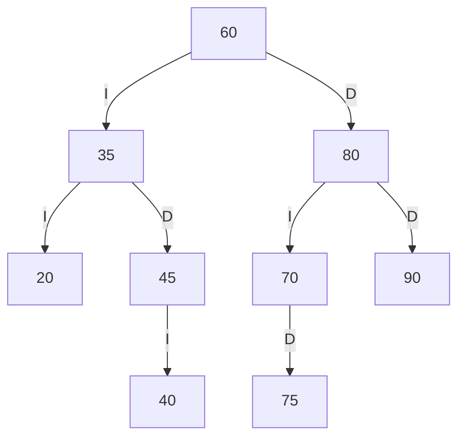
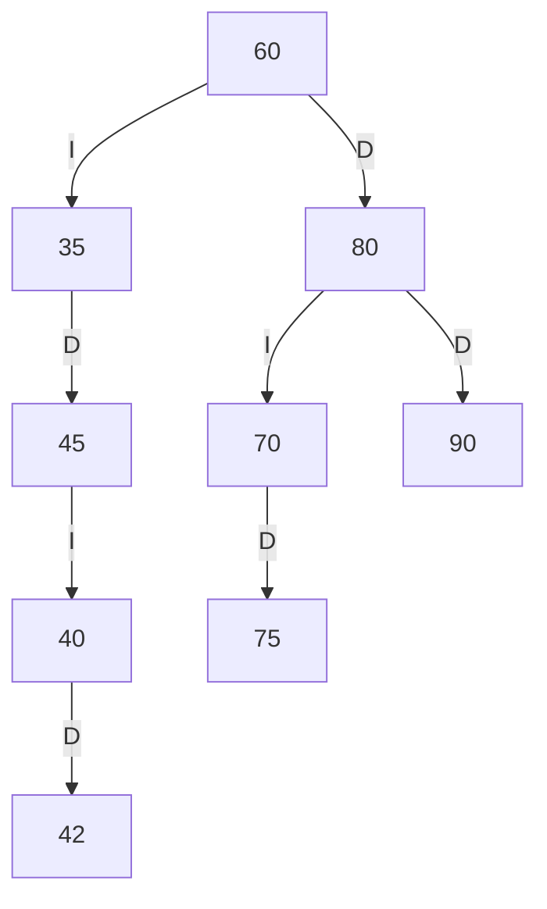
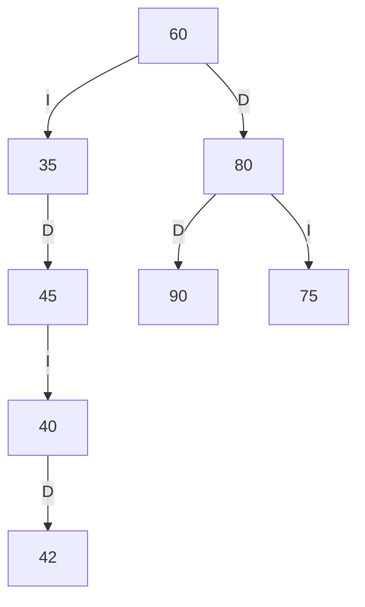
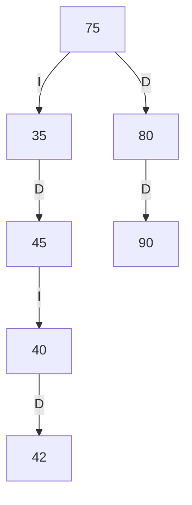

# Trazas del ABB de SW-E1

## Codigos personales

Faltan los cuatro ultimos digitos de la cedula para sustituir estos marcadores. A partir de `abcd`, se forman `ab`, `bc` y `cd`; cada valor debe ser positivo, distinto de los demas y no estar ya en el arbol. Si es cero, esta repetido o ya existe, se incrementa en uno hasta cumplir las condiciones.

Marcadores pendientes: `AB`, `BC`, `CD`.

## ABB construido con la secuencia base

Insercion en orden: `60, 35, 80, 20, 45, 70, 90, 40, 75`.



Al incorporar los codigos personales, el arbol cambia segun esos valores. Para obtener esa variante, insertar `AB`, `BC` y `CD`, en ese orden, en el ABB anterior.

## Recorridos

- Preorden: `60 35 20 45 40 80 70 75 90`.
- Inorden: `20 35 40 45 60 70 75 80 90`.
- Posorden: `20 40 45 35 75 70 90 80 60`.

## Traza del preorden

```text
entra 60
VISITA 60
  entra 35
  VISITA 35
    entra 20
    VISITA 20
      null -> regresa
      null -> regresa
    entra 45
    VISITA 45
      entra 40
      VISITA 40
        null -> regresa
        null -> regresa
      null -> regresa
  entra 80
  VISITA 80
    entra 70
    VISITA 70
      null -> regresa
      entra 75
      VISITA 75
        null -> regresa
        null -> regresa
    entra 90
    VISITA 90
      null -> regresa
      null -> regresa
Secuencia PREORDEN: 60 35 20 45 40 80 70 75 90
```

## Eliminaciones

Se inserta primero `42`; queda como hijo derecho de `40`. Luego se elimina `20` (hoja), `70` (un hijo, `75`) y `60` (dos hijos; sucesor inorden `75`).

Despues de eliminar la hoja `20`:



Despues de eliminar `70`, que tenia un hijo derecho `75`:



Despues de eliminar `60`, el sucesor `75` ocupa la raiz:



Preorden final: `75 35 45 40 42 80 90`.

## Salidas de comprobacion

Los casos obligatorios quedan representados por estas salidas del programa y las pruebas automatizadas:

| Punto | Salida esperada | Coincide |
|---|---|---|
| Solo la raiz | `Altura: 0`, `Hojas: 1` | Si |
| Estructura inicial | `Altura: 2`, `Hojas: 4`, `Total de libros: 13` | Si |
| Niveles `BIB`, `sw`, `SW-E2`, `XYZ` | `0`, `1`, `2`, `-1` | Si |
| Agregar estante como hijo de `BIB` | `No se pudo agregar la unidad.` | Si |
| Codigo de libro repetido | `Ya existe un libro con ese codigo.` | Si |
| Camino a `42` | `[60, 35, 45, 40]` | Si |
| Rango `40..75` | `Cantidad: 5` | Si |
| Buscar/modificar/eliminar `999` | `null` / `false` / `false` en API | Si |
| Codigo de libro `0` | `IllegalArgumentException` | Si |
| Nieto fuera de rango en el ABB | `ABB valido: false` | Si |
| Ejecucion de pruebas | `14/14 pruebas OK` | Pendiente de ejecutar con JDK |

Los resultados relativos a los tres codigos personales quedan pendientes de reemplazar los marcadores con los digitos proporcionados.